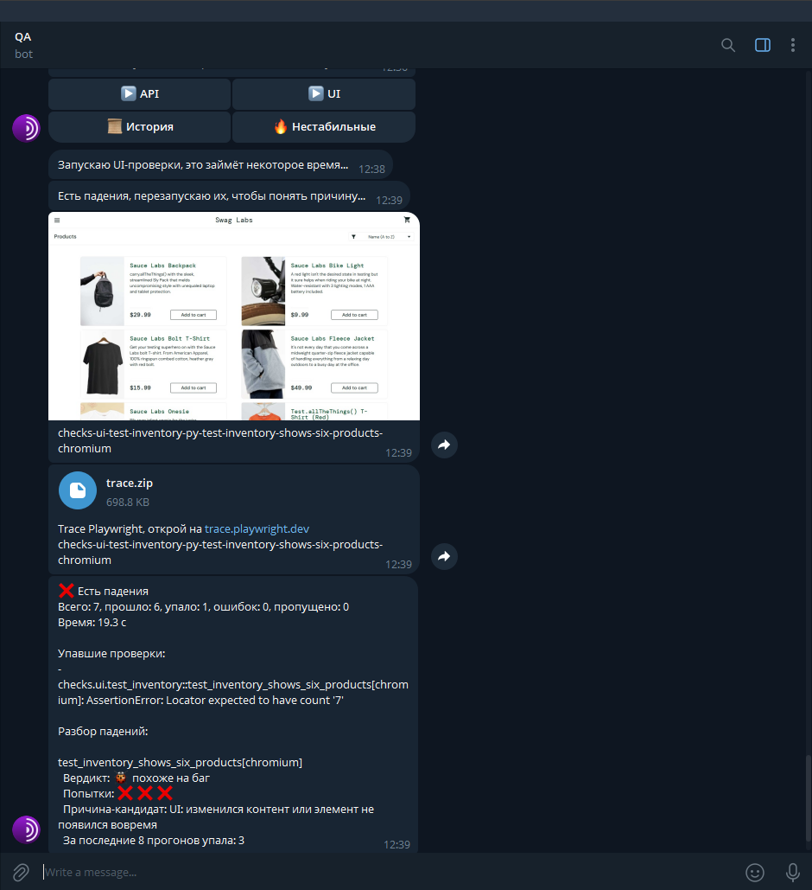
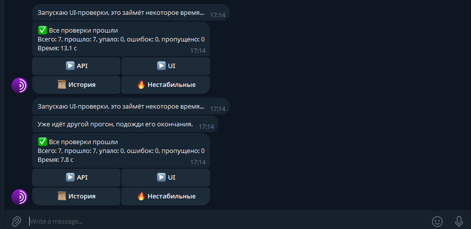
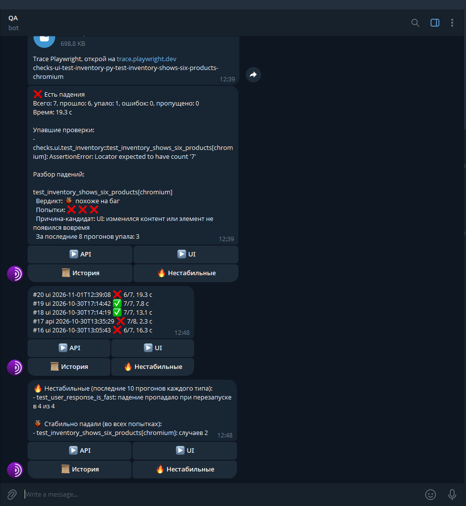
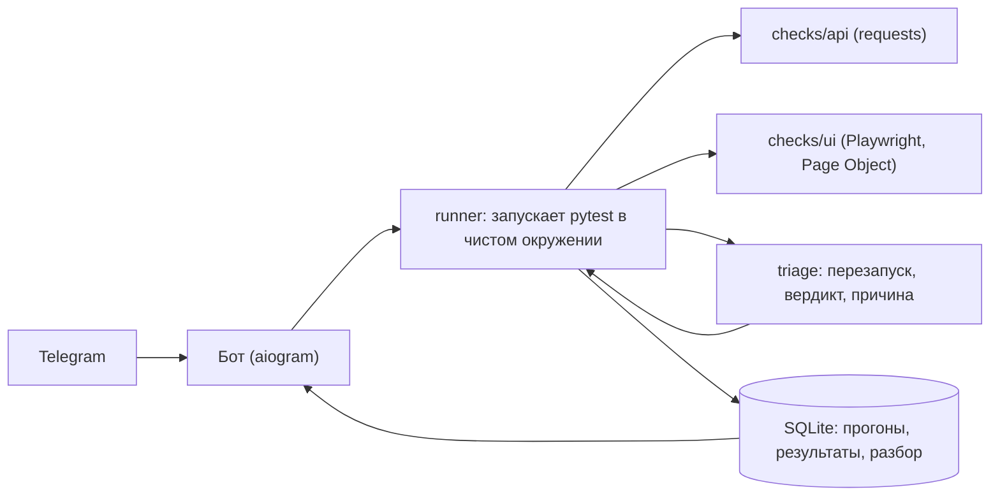

# AutoQA Sentinel


Telegram-бот для запуска автотестов с телефона. Он запускает API- и UI-проверки, присылает отчёт со скриншотом падения и сам разбирается, **почему** проверка упала: перезапускает её и выносит вердикт «нестабильная» или «похоже на баг».

Проект на Python: aiogram, pytest, requests, Playwright, SQLite, GitHub Actions.

## Зачем это нужно

Упавший автотест не всегда означает дефект. Часть падений вызвана сетью, медленным ответом сервиса или гонкой в интерфейсе. Такие проверки называют нестабильными (flaky), и разбирать их вручную долго. Бот делает первый шаг разбора автоматически и показывает результат в мессенджере.

## Скриншоты

**Команды, API-прогон и разбор нестабильной проверки**


**Падение UI-проверки: скриншот страницы, три попытки, вердикт «похоже на баг»**



**Успешный UI-прогон и защита от параллельного запуска (повторное нажатие получает «Уже идёт другой прогон»)**



**История прогонов и нестабильные проверки (`/history`, `/flaky`)**



## Что умеет

| Команда / кнопка | Что делает |
|---|---|
| `/run_api`, ▶ API | запускает API-проверки и присылает итог |
| `/run_ui`, ▶ UI | запускает UI-проверки в браузере (Playwright), при падении присылает скриншот страницы и trace (запись действий браузера) |
| `/last` | последний прогон |
| `/history`, 📜 История | последние 5 прогонов |
| `/flaky`, 🔥 Нестабильные | итоги разбора падений за последние 10 прогонов: нестабильные проверки (падение пропадало при перезапуске) и проверки, которые падали во всех попытках |
| `/start`, `/ping`, `/id` | служебные |

Запускать проверки и смотреть результаты может только владелец бота (Telegram ID из `.env`).

## Разбор падений

Если в прогоне есть упавшие проверки, бот выполняет такие шаги:

1. Перезапускает **только упавшие** проверки до двух раз в том же изолированном окружении. Проверка, которая прошла, больше не запускается.
2. Выносит вердикт по всем попыткам (первый запуск тоже считается):
   - упала во всех попытках: **«похоже на баг»**;
   - хотя бы раз прошла: **«нестабильная»**.
3. Подбирает причину-кандидата по тексту ошибки: таймаут, недоступность сервиса, код ошибки HTTP, превышение порога времени, изменение содержимого страницы.
4. Берёт из SQLite историю: сколько раз эта проверка упала за последние 10 прогонов.

Пример отчёта:

```
❌ Есть падения
Всего: 8, прошло: 7, упало: 1, ошибок: 0, пропущено: 0
Время: 4.2 с

Упавшие проверки:
- checks.api.test_timing::test_user_response_is_fast: assert 0.490978 < 0.3

Разбор падений:

test_user_response_is_fast
  Вердикт: 🔥 нестабильная
  Попытки: ❌ ✅
  Причина-кандидат: превышен порог времени ответа
  За последние 9 прогонов упала: 3
```

Для упавших UI-проверок бот присылает ещё **trace Playwright** (`trace.zip`): пошаговую запись действий браузера со снимками страницы на каждом шаге. Открыть её можно командой `python -m playwright show-trace trace.zip` или на trace.playwright.dev.

Список `/flaky` строится на этих вердиктах, а не на сравнении результатов разных прогонов. Иначе изменение самого теста (проходил, потом его поменяли и он стабильно падает) выглядело бы как нестабильность.

Вердикт это сигнал для человека, а не доказательство. Три попытки показывают, что проверка нестабильна, но не гарантируют, что стабильное падение вызвано дефектом продукта.

## Как устроен



```
autoqa-sentinel/
├── app/
│   ├── config.py      настройки из .env
│   ├── handlers.py    команды и кнопки бота
│   ├── runner.py      запуск pytest, разбор JUnit XML
│   ├── triage.py      перезапуск упавших, вердикт, причина
│   └── storage.py     SQLite
├── checks/
│   ├── api/           проверки API
│   └── ui/            проверки UI, Page Object в pages/
├── tests/             тесты самого сервиса
├── main.py
└── .github/workflows/ci.yml
```

`checks` это проверки внешних систем, которые запускает бот. `tests` это тесты собственного кода сервиса.

## Безопасность

- **Секреты не попадают в проверки.** Раннер запускает pytest в окружении без `BOT_TOKEN` и `ALLOWED_USER_ID` (`clean_env()`). Это проверяет тест `test_bot_token_is_not_visible_to_checks`, который выполняется внутри запущенных проверок.
- **Доступ только владельцу.** Каждая команда и кнопка сверяется с `ALLOWED_USER_ID`. Если ID не задан, бот не запускается.
- **Один прогон за раз.** Повторное нажатие во время выполнения получает ответ «Уже идёт другой прогон». Перезапуски упавших проверок тоже выполняются под этой блокировкой.
- **Таймаут прогона.** Зависший pytest принудительно завершается через 120 секунд.
- `.env`, `sentinel.db` и `artifacts/` исключены из git.

## Что проверяется

- **API** ([JSONPlaceholder](https://jsonplaceholder.typicode.com)), 8 проверок: получение пользователя и типы полей, параметризованная проверка пользователей 1, 2 и 10, ответ 404 на несуществующего, создание записи (POST, код 201 и возврат отправленных данных), скорость ответа, недоступность секретов бота.
- **UI** ([saucedemo.com](https://www.saucedemo.com)), 7 проверок: успешный вход, четыре вида ошибок входа (неверный пароль, пустой логин, пустой пароль, заблокированный пользователь), шесть товаров в каталоге, счётчик корзины. Использован Page Object.
- **Сам сервис**, 30 тестов: разбор JUnit XML, очистка окружения, сбор артефактов, хранилище, итоги разбора падений для `/flaky`, вердикты и причины.

Проверка скорости `test_user_response_is_fast` задаёт намеренно жёсткий порог 0,3 с и поэтому иногда падает из-за задержки сети. Она служит живым примером нестабильной проверки для разбора падений.

Проверяются только публичные демонстрационные сервисы, созданные для практики.

## Окружение

Проект разработан и проверен на этих версиях, они зафиксированы в `requirements.txt`:

| Компонент | Версия |
|---|---|
| Python | 3.13 (проверено на 3.13.16) |
| aiogram | 3.31.0 |
| pytest | 9.1.1 |
| pytest-playwright | 0.10.0 |
| Playwright | 1.64.1 |
| requests | 2.34.2 |
| python-dotenv | 1.2.4 |

Разработка велась на Windows, CI запускается на Ubuntu.

## Запуск

1. Python 3.13 и виртуальная среда: `python -m venv venv`, затем активация (в PowerShell: `venv\Scripts\Activate.ps1`).
2. `pip install -r requirements.txt`
3. `python -m playwright install chromium`
4. Создать бота через @BotFather. Скопировать `.env.example` в `.env` и указать `BOT_TOKEN` и `ALLOWED_USER_ID` (свой ID покажет команда `/id` у любого бота, например у @userinfobot).
5. `python main.py`

Тесты вручную: `pytest tests`, `pytest checks/api`, `pytest checks/ui` (с параметрами `--headed --slowmo 500` видно работу браузера).

## CI

GitHub Actions на каждый push и pull request запускает тесты сервиса, API-проверки и UI-проверки. Проверка скорости в CI пропускается: она нестабильна по замыслу и сделала бы статус сборки случайным. Внешние сайты иногда бывают недоступны, тогда прогон можно повторить.

## Ограничения

- Бот работает на компьютере владельца (long polling) и недоступен, пока компьютер выключен.
- Время в истории местное время компьютера.
- Результаты зависят от доступности публичных тестовых сайтов и качества сети.
- Причина-кандидат определяется простыми правилами по тексту ошибки, а не анализом кода.

## Идеи на будущее

- Прогон по расписанию и уведомление только при изменении статуса.
- Объяснение причины падения с помощью языковой модели.
